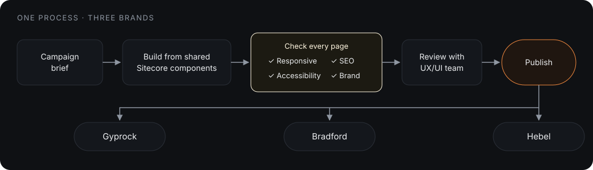

## The problem

CSR is a leading Australian building-products company with separate websites for brands like **Gyprock**, **Bradford** and **Hebel**. Each brand has its own look and audience, but they all ran on one Sitecore setup and changed often for marketing campaigns.

The risk with several brand sites on one CMS is drift: a component used slightly differently on each site, a missing alt text, a heading out of order, a campaign page that looks right on desktop and breaks on a phone. Each one is small, but together they make a brand look careless.

## What I did

From February to October 2024 I managed and updated content across the CSR brand sites in Sitecore:

- **Built responsive campaign pages from modular components** rather than one-off layouts, so each brand stayed consistent.
- **Checked every page before publishing** for responsive layout, SEO, accessibility and brand guidelines.
- **Worked with the UX/UI team** to turn campaign designs into SEO-friendly, responsive pages.
- **Kept content accurate and consistent** across all three brands as campaigns came and went.

## Key decisions

- **Components over custom layouts.** Reusing the same building blocks across brands is what keeps three sites looking deliberate instead of drifting apart.
- **Check before publishing, not after.** Responsive, SEO, accessibility and brand checks happen on every page before it goes live, when fixes are cheap.
- **One process for every brand.** The same steps for Gyprock, Bradford and Hebel, so nothing depends on remembering a special case.

## What it led to

This work is where "good websites don't happen by accident" comes from. It led directly to my current role as a Web Publisher at Acuity Analytics, where I do the same publishing and QA for global clients, using Siteimprove to audit accessibility and SEO.
