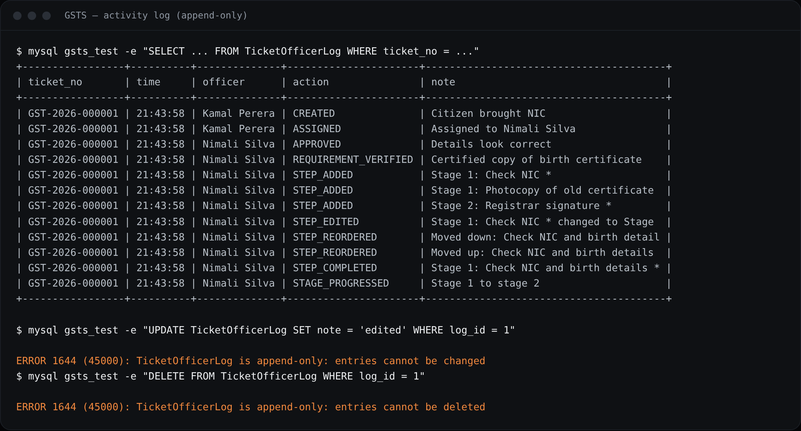
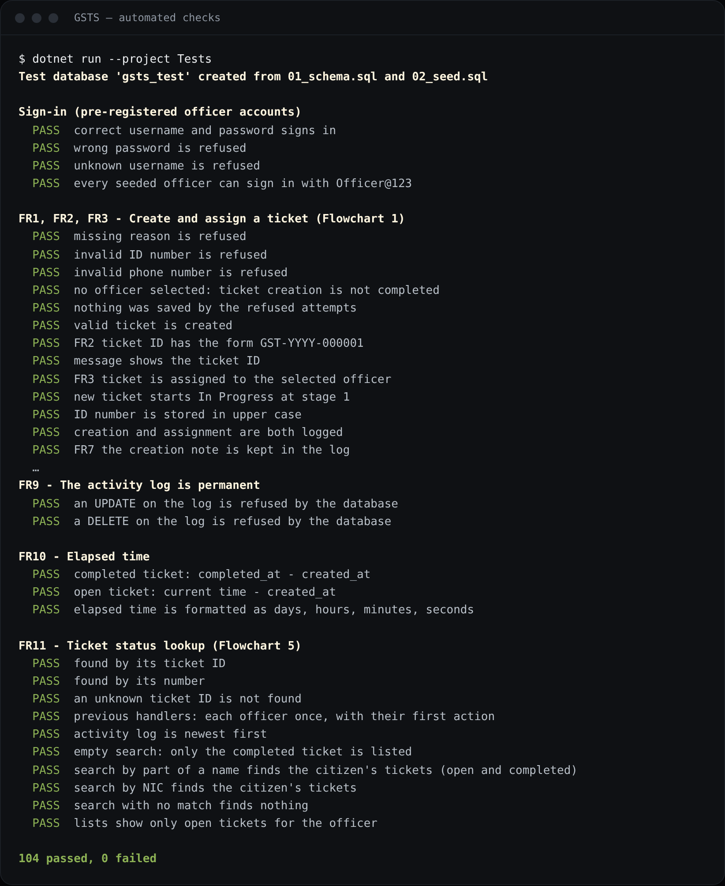

## The problem

Sri Lankan government offices often handle walk-in requests, like ID renewals and certificates, on paper. Requests get lost, nobody clearly owns them, and there’s no reliable history when several officers are involved.

## What I built

A desktop app that turns every request into a ticket with an ID like `GST-2026-000003`, an owner, defined steps and a full history.

- **Enforced progress:** a ticket can’t move to the next stage while a compulsory step is open.
- **Peer review:** the next officer must approve or flag the previous officer’s work before editing.
- **Append-only log:** every action is timestamped, and database triggers block edits and deletes.
- **Live timer:** time since the ticket was created is always on screen.

## Key decisions

- **Three layers** (Forms → Services → Data). Only one class runs SQL.
- **The review rule is enforced twice**, in the UI and in every service method, so it holds even if a screen changes later.
- **Each change and its log entry share one transaction**, so either both are saved or neither is.
- **The log is protected by the database itself**, not just the app. Even a direct SQL `UPDATE` or `DELETE` is refused:

- **PBKDF2 password hashing** and parameterised SQL throughout.
- Every open design question is recorded with a decision and the reason for it.

## Testing

The test suite runs the app’s real service code against a fresh MariaDB test database, built from the project’s own SQL scripts. Each functional requirement has its own group of checks, including the ones that must *fail*: wrong passwords, invalid ID numbers, edits to the log.

## Result

All 11 functional requirements implemented and traced to code, with **104 automated checks passing and 0 failing**.
